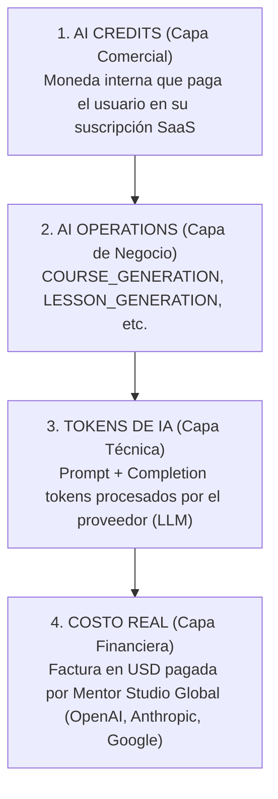

# Mentor Studio Global — Modelo Económico de AI Credits & Análisis de Costes

## 1. Principios del Modelo Económico

El sistema de **AI Credits** de Mentor Studio Global se concibe como una moneda interna de capacidad SaaS para profesores, academias y estudiantes. Su propósito principal es desacoplar la complejidad técnica de las llamadas a los LLM (Large Language Models) y ofrecer una experiencia de usuario clara, predecible y económicamente sostenible.

### Principios Fundamentales:

1. **Unidad Interna de Capacidad**: Un AI Credit no equivale directamente a un número fijo de tokens, ni a 1 dólar, ni a 1 llamada API. Representa el **valor percibido y la complejidad relativa** de una operación dentro de la plataforma.
2. **Aislamiento Estricto de Bolsas**:
   - **Teacher Credits**: Utilizados por creadores de contenido (profesores, administradores) para estructurar cursos, generar lecciones, actividades, quizzes y landing pages.
   - **Student Credits**: Utilizados por estudiantes para interactuar con herramientas de asistencia activa (AI Tutor, AI Feedback). Nunca se permite la contaminación ni transferencia de saldo entre ambas bolsas.
3. **Protección de Margen Bruto**: El valor asignado a cada crédito garantiza que, incluso bajo patrones de uso intensivo por parte del usuario, el margen bruto de la infraestructura de IA de Mentor Studio Global se mantenga **superior al 85-90%**.
4. **Política de Rollover Controlado**: El sobrante mensual no consumido se transfiere al mes siguiente hasta un límite máximo estricto por plan, incentivando el uso continuo y evitando la acumulación indeterminada de pasivo financiero en los balances.

---

## 2. Diferencia entre AI Credits, Tokens y Costo Real

Es crucial mantener la separación conceptual en tres capas independientes:

| Capa | Entidad | Definición | Propietario | Ejemplo |
|---|---|---|---|---|
| **Comercial** | **AI Credits** | Capacidad fija descontada de la billetera del tenant. | Usuario / Tenant | 5 Créditos Teacher por generar un borrador de curso |
| **Técnica** | **Tokens de IA** | Volumen de texto (prompt + respuesta) procesado por la red neuronal. | Sistema / API | 1,850 tokens (450 prompt + 1,400 respuesta) |
| **Financiera** | **Costo Real ($ USD)** | Gasto real en dólares cobrado por el proveedor por el volumen de tokens. | Mentor Studio Global | $0.00075 USD (usando modelos tipo Gemini 1.5 Flash / GPT-4o-mini) |

### Ejemplo Numérico de Margen:
- **Plan STARTER**: $19.00 USD/mes → Otorga 150 Teacher Credits (~$0.126 USD recaudados por crédito).
- **Operación `LESSON_GENERATION`**:
  - Consume: 2 AI Credits (Ingreso implícito: ~$0.25 USD).
  - Consume técnicamente: ~2,500 tokens en GPT-4o-mini / Gemini 1.5 Flash.
  - Costo Real API: ~$0.0012 USD.
  - **Margen Bruto de la Operación**: **> 99.5%**.

---

## 3. Modelo de Consumo por Operación

Cada operación (`AIOperation`) en el catálogo [src/modules/ai/ai.catalog.ts](file:///c:/Users/Jorge/Desktop/Academia%20X/Academia%20X/src/modules/ai/ai.catalog.ts) posee una configuración determinista:

- **`creditCost`**: Cantidad de créditos descontados por transacción exitosa.
- **`creditType`**: Bolsa asignada (`TEACHER` o `STUDENT`).
- **`tier`**: Calidad del modelo subyacente:
  - **`FREE`** ($0.00 coste API): Slugs, formateos, validaciones.
  - **`ECONOMIC`**: Modelos ultra-rápidos de bajo costo (Gemini 1.5 Flash, GPT-4o-mini).
  - **`PREMIUM`**: Modelos de alto razonamiento y creatividad (Claude 3.5 Sonnet, GPT-4o).
- **`dailyLimits`**: Límite máximo de ejecuciones diarias por plan para evitar automatizaciones o abusos.

---

## 4. Análisis del Catálogo Actual

A continuación se detalla la configuración vigente en el sistema:

| Operación (`AIOperation`) | Tipo de Crédito | Costo Actual (Créditos) | Tier de IA | Límite Diario Starter | Límite Diario Pro | Límite Diario Academy |
|---|---|---:|---|---:|---:|---:|
| **`COURSE_GENERATION`** | `TEACHER` | **5** | `PREMIUM` | 2 | 5 | 15 |
| **`LESSON_GENERATION`** | `TEACHER` | **2** | `ECONOMIC` | 10 | 25 | 75 |
| **`ACTIVITY_GENERATION`** | `TEACHER` | **1** | `ECONOMIC` | 20 | 50 | 150 |
| **`QUIZ_GENERATION`** | `TEACHER` | **1** | `ECONOMIC` | 20 | 50 | 150 |
| **`LANDING_GENERATION`** | `TEACHER` | **8** | `PREMIUM` | 1 | 3 | 8 |
| **`LESSON_REGENERATION`** | `TEACHER` | **1** | `ECONOMIC` | 10 | 25 | 75 |
| **`COURSE_REGENERATION`** | `TEACHER` | **3** | `PREMIUM` | 2 | 5 | 15 |
| **`AI_TUTOR`** | `STUDENT` | **1** | `ECONOMIC` | 0 | 200 | 800 |
| **`AI_FEEDBACK`** | `STUDENT` | **1** | `ECONOMIC` | 0 | 200 | 800 |

---

## 5. Simulación de Consumo del Plan STARTER

- **Precio**: $19.00 USD/mes.
- **Cuota Mensual**: 150 Teacher Credits / 0 Student Credits.
- **Rollover Máximo**: 30 Teacher Credits.

### Escenarios de Uso Mensual en STARTER:

- **Escenario A (Creador de Cursos Integrales)**:
  - Generación de 2 borradores completos de curso (54 cr x 2 = 108 cr).
  - 1 Landing Page promocional (8 cr).
  - 34 operaciones de edición/regeneración o actividades extra (34 cr).
  - **Total**: 150 créditos utilizados (100% de la cuota).

- **Escenario B (Creador de Lecciones Granulares)**:
  - 1 Estructura inicial de curso (5 cr).
  - 50 Lecciones redactadas individualmente (50 x 2 cr = 100 cr).
  - 30 Actividades pedagógicas (30 x 1 cr = 30 cr).
  - 15 Quizzes de evaluación (15 x 1 cr = 15 cr).
  - **Total**: 150 créditos utilizados.

---

## 6. Simulación de Consumo del Plan PRO

- **Precio**: $79.00 USD/mes.
- **Cuota Mensual**: 600 Teacher Credits / 200 Student Credits.
- **Rollover Máximo**: 100 Teacher / 50 Student.

### Escenarios de Uso Mensual en PRO:

- **Bolsa del Profesor (600 cr)**:
  - Capacidad para crear **~11.1 Cursos Completos Estándar** (a 54 cr por curso completo).
  - O combinaciones como: 10 Cursos completos (540 cr) + 3 Landings (24 cr) + 20 Regeneraciones (20 cr) + 16 Actividades extra (16 cr) = 600 cr.
- **Bolsa de Estudiantes (200 cr)**:
  - Permite a los estudiantes inscritos realizar **200 consultas interactivas** al AI Tutor o recibir AI Feedback en sus entregas.

---

## 7. Simulación de Consumo del Plan ACADEMY

- **Precio**: $199.00 USD/mes.
- **Cuota Mensual**: 2,000 Teacher Credits / 800 Student Credits.
- **Rollover Máximo**: 300 Teacher / 150 Student.

### Escenarios de Uso Mensual en ACADEMY:

- **Bolsa del Profesor (2,000 cr)**:
  - Capacidad para **~37.0 Cursos Completos Estándar** al mes.
  - Diseñado para institutos y academias con múltiples docentes creando cursos de forma continua.
- **Bolsa de Estudiantes (800 cr)**:
  - Soporta **800 interacciones al mes** de estudiantes asistidos por IA.

---

## 8. Ejemplo de Creación de un Curso Completo (Benchmark de Referencia)

Definimos como **"Curso Completo Estándar"** un programa pedagógico de 4 módulos con un total de 10 lecciones, actividades, quizzes, regeneraciones de ajuste y su landing page.

### Desglose de Consumo (Catálogo Actual):

| Componente del Curso | Operación | Cantidad | Costo Unitario | Subtotal Créditos |
|---|---|---:|---:|---:|
| Estructura y temario inicial | `COURSE_GENERATION` | 1 | 5 cr | 5 cr |
| Redacción de contenido pedagógico | `LESSON_GENERATION` | 10 | 2 cr | 20 cr |
| Ejercicios prácticos pedagógicos | `ACTIVITY_GENERATION` | 10 | 1 cr | 10 cr |
| Quizzes de evaluación | `QUIZ_GENERATION` | 5 | 1 cr | 5 cr |
| Ajustes y regeneraciones de lecciones | `LESSON_REGENERATION` | 3 | 1 cr | 3 cr |
| Ajustes de estructura global | `COURSE_REGENERATION` | 1 | 3 cr | 3 cr |
| Copywriting de Landing Page | `LANDING_GENERATION` | 1 | 8 cr | 8 cr |
| **TOTAL CURSO COMPLETO ESTÁNDAR** | | | | **54 AI Credits** |

> **Nota sobre la referencia de negocio**: Si la referencia estratégica es que 100 AI Credits representen el orden de magnitud de la capacidad para 1 curso completo más iteraciones amplias de edición, el consumo actual de **54 créditos** por curso completo encaja perfectamente, permitiendo al profesor en un plan STARTER (150 cr) crear ~2.7 cursos completos o realizar amplias regeneraciones.

---

## 9. Ejemplo de Creación de una Lección

Para redactar y perfeccionar una lección individual con sus recursos:

- 1 `LESSON_GENERATION`: 2 cr (Contenido pedagógico principal)
- 1 `ACTIVITY_GENERATION`: 1 cr (Ejercicios asociados)
- 1 `QUIZ_GENERATION`: 1 cr (Evaluación rápida de la lección)
- 1 `LESSON_REGENERATION`: 1 cr (Refinamiento de tono o estilo)
- **Total por Lección Refinada**: **5 AI Credits**.

---

## 10. Ejemplo de Generación de Actividades y Quizzes

- **1 `ACTIVITY_GENERATION` (1 cr)**: Genera 3 a 5 actividades prácticas con instrucciones, entregables esperados y rúbricas simples.
- **1 `QUIZ_GENERATION` (1 cr)**: Genera un cuestionario de 5 preguntas de opción múltiple con explicaciones pedagógicas de las respuestas correctas.

---

## 11. Ejemplo de Landing Page

- **1 `LANDING_GENERATION` (8 cr)**: Genera la estructura comercial completa de una landing de alta conversión:
  - Hero Section (Titular, subtitular, propuesta de valor).
  - Para quién es el curso (Target audience).
  - Lo que aprenderá el estudiante (Puntos clave).
  - Preguntas Frecuentes (FAQs).
  - Llamados a la acción (CTA) persuasivos.

---

## 12. Ejemplo de Regeneraciones

- **`LESSON_REGENERATION` (1 cr)**: Permite solicitar a la IA que re-escriba una lección ajustando la dificultad (ej. de B1 a B2) o cambiando el enfoque sin volver a cobrar el coste total de generación (2 cr).
- **`COURSE_REGENERATION` (3 cr)**: Re-estructura todo el temario borrador cuando el profesor decide cambiar la orientación general del curso.

---

## 13. Riesgo de Precios Demasiado Bajos (Subvaloración)

1. **Erosión de Márgenes en Modelos Costosos**: Si `LESSON_GENERATION` se mantiene en 2 cr y el sistema evoluciona hacia el uso de modelos GPT-4o / Claude 3.5 Sonnet para lecciones extensas (~5,000 tokens), el costo API aumentaría 10x-20x mientras el cobro en créditos sigue fijo en 2 cr.
2. **Confusión sobre el alcance de `COURSE_GENERATION`**: Al costar solo 5 cr, el usuario podría asumir erróneamente que `COURSE_GENERATION` debería generar mágicamente las 50 lecciones completas con texto redactado en lugar de solo la estructura/outline.

---

## 14. Riesgo de Precios Demasiado Altos (Sobrevaloración)

1. **Fricción en la Adopción**: Si `LESSON_GENERATION` aumentara a 10 cr, un profesor en STARTER (150 cr) solo podría generar 15 lecciones al mes, sintiendo la plataforma restrictiva.
2. **Parálisis por Análisis**: Precios elevados desincentivan la experimentación y el uso continuo de la IA.

---

## 15. Recomendación de Estructura de Precios (Para Evaluación Futura)

Sin alterar los valores actuales de código en esta fase, se recomienda evaluar la siguiente **Evolución del Catálogo**:

| Operación | Costo Actual | Costo Recomendado Futuro | Razón del Ajuste |
|---|---:|---:|---|
| `COURSE_GENERATION` | 5 cr | **8 cr** | Refleja mejor el uso de modelos PREMIUM (Claude 3.5 / GPT-4o) para estructuración estratégica. |
| `LESSON_GENERATION` | 2 cr | **3 cr** | Absorbe el crecimiento en longitud de los textos de lecciones. |
| `ACTIVITY_GENERATION` | 1 cr | **1 cr** | Mantener accesible (operación ligera). |
| `QUIZ_GENERATION` | 1 cr | **1 cr** | Mantener accesible (operación ligera). |
| `LANDING_GENERATION` | 8 cr | **10 cr** | Alta potencia comercial y uso de modelos PREMIUM de alta conversión. |
| `LESSON_REGENERATION` | 1 cr | **2 cr** | Mantiene una proporción justa frente a la generación inicial de lección (3 cr). |
| `COURSE_REGENERATION` | 3 cr | **5 cr** | Refleja re-estructuración completa. |
| `AI_TUTOR` | 1 cr | **1 cr** | Accesible para estudiantes en paquete PRO/ACADEMY. |
| `AI_FEEDBACK` | 1 cr | **1 cr** | Accesible para estudiantes. |

*Bajo esta recomendación futura, la creación de 1 Curso Completo Estándar consumiría **~74 créditos**, muy cercano al benchmark estratégico de 100 créditos.*

---

## 16. Relación Conceptual entre Créditos, Tokens y Costo de Infraestructura

- **Modelos ECONOMIC** (Gemini 1.5 Flash / GPT-4o-mini):
  - Costo Promedio: ~$0.15 USD por 1M de tokens de entrada / $0.60 USD por 1M de salida.
  - Promedio de tokens por `LESSON_GENERATION`: 2,500 tokens → Costo API: **~$0.001 USD**.
- **Modelos PREMIUM** (Claude 3.5 Sonnet / GPT-4o):
  - Costo Promedio: ~$3.00 USD por 1M de tokens de entrada / $15.00 USD por 1M de salida.
  - Promedio de tokens por `LANDING_GENERATION`: 3,500 tokens → Costo API: **~$0.035 USD**.

### Conclusión de Infraestructura:
Con un ingreso promedio de $0.10 - $0.12 USD por AI Credit vendido en los planes SaaS, **el costo directo de API representa entre el 1% y el 5% del ingreso por crédito**, garantizando la sostenibilidad financiera del sistema.

---

## 17. Recomendaciones para Mantener el Margen Económico

1. **Routing Dinámico de Modelos**: Utilizar siempre modelos `ECONOMIC` para lecciones, actividades y quizzes, reservando modelos `PREMIUM` estrictamente para `COURSE_GENERATION` y `LANDING_GENERATION`.
2. **Límites Diarios Guardián (`dailyLimits`)**: Mantener activos los límites diarios por plan configurados en `ai.catalog.ts` para evitar ataques de denegación de billetera o botnet scraping.
3. **Optimización de Prompts**: Recortar prompts del sistema redundantes para minimizar los tokens de entrada.

---

## 18. Recomendaciones para Futuras Operaciones

Para las próximas fases del proyecto (ej. PASO 4.4.2 y posteriores), se sugiere la asignación previa en catálogo:

- **`AUDIO_OVERVIEW_GEN`** (`TEACHER` / Tier `PREMIUM`): **12 AI Credits** (Generación de audio sintético pedagógico).
- **`STUDENT_QUIZ_EVAL`** (`STUDENT` / Tier `ECONOMIC`): **1 AI Credit** (Evaluación automatizada de exámenes de estudiantes).
- **`CERTIFICATE_AI_SUMMARY`** (`TEACHER` / Tier `FREE`): **0 AI Credits** (Resumen ejecutivo del certificado).
